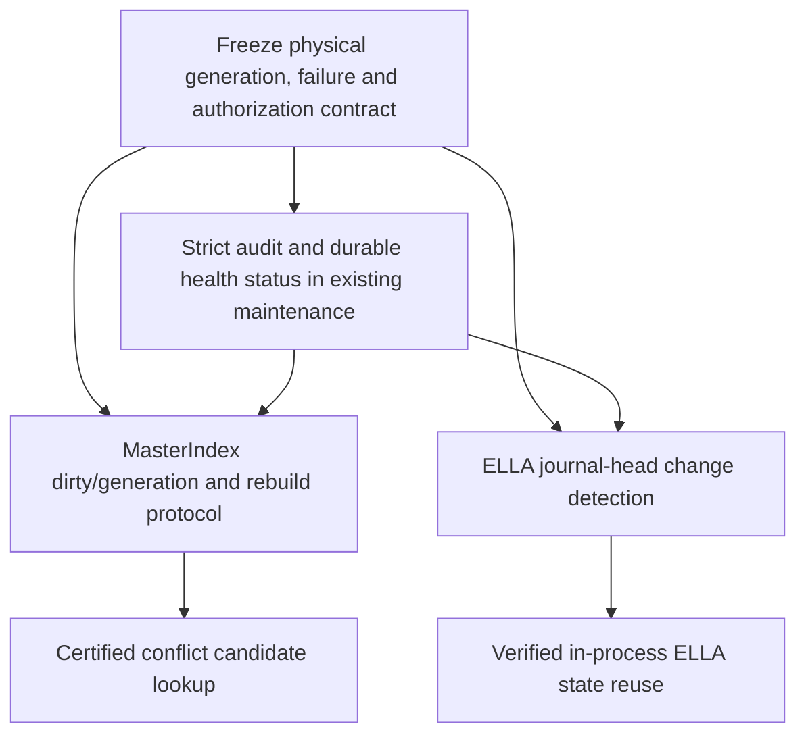

# Dependencies and ownership

Order recommended for implementation approval: **(1)** source-generation/strict audit contract and maintenance health, **(2)** certified MasterIndex conflict lookup, **(3)** ELLA warm-state cache and head detection. ELLA need not depend on conflict indexing for its own state, but its `project` calls `conflicts_for`, so measuring ELLA after conflict work gives cleaner evidence. The two accelerations share failure/generation principles; they need not share an epistemic data structure.

| Responsibility | Reuse / modification / new / no change |
| --- | --- |
| Conflict record truth, status history, ACL, REST/MCP contract | **Reuse**, no semantic change. |
| MasterIndex metadata, startup rebuild, checkpoint, writer callback | **Modify** for certified completeness and cross-handle invalidation; no dedicated conflict index demonstrated necessary. |
| Namespace-wide verification | **New operation** inside existing maintenance lifecycle; strict physical read and durable health status are new integration points. |
| WAL/native record transaction and shared store lock | **Reuse**, possibly **modify** to expose a durable generation that cannot miss a commit. Exact native change is not yet frozen. |
| Native ELLA reducer/journal/full-state events | **Reuse**, no reducer or event schema change required for initial warm-cache approach. |
| ELLA current head, retry lookup and cache invalidation | **Modify/add** Python ledger state management and reliable journal change detection. |
| Memory history/lineage; graph/tags; observer source | **No replacement**. Graph/tags remain derived; memory versions and ELLA journal stay distinct. |

Cross-cutting invariant: every served accelerated answer is tied to a verified physical source generation, and any unresolvable mismatch is reported as an integrity/recovery error. Independent audit may verify broad physical state but must not alter FUR, ELLA judgments, LADC, Pairing or observation source. Normal reads verify the records actually used.
