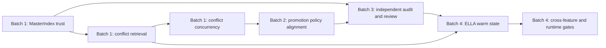

# Track 7 complete upgrade roadmap — implementation contract for review

**Status: planning only; all seven upgrades below are unimplemented.** Snapshot: `codex/ember-split-feedback-candidate04`, HEAD `f183346547cd210f58ca0a6b23df91a56be22b66`, 2026-10-15. The Atlas source-version log records the dirty working tree. Evidence is current source and inspected test assertions; Phase 1–3 timing/counterexamples are historical isolated research, and Phase 4 is represented by the canonical map/transcript summary rather than a separate report file. No test, build, benchmark or live probe was run for this contract. Read this with `08_EXISTING_MECHANISM_RECONCILIATION.md`; earlier `02`–`07` files are alternatives where they differ.

## Boundaries and dependencies

The physical `.ember` record and its hash are source truth; supersession/deprecation sidecars provide version visibility; MasterIndex is derived candidate metadata; graph edges are relationship history; CONFLICT records own mapped status; ELLA RAW events own epistemic state. Promotion admits proposals and never asserts truth. Existing native WAL, shared store lock, memory CAS, immutable history, native ELLA reducer, FUR, Pairing, LADC and observer source are retained (`embers/storage/store.py:83-114,192-290`; `engine/writer.py:64-259`; `db.py:789-1000`; `cognitive/epistemic.py:25-302`; `engine/promotion.py:141-321`).

Each batch starts with the **existing-behavior tests**, then implements only its listed change, then runs the changed-behavior and recovery tests. A failing correctness test stops the batch. A source change needs separate user approval under the Atlas maintenance contract; approval of this roadmap alone is not source-change approval.

## Batch 1 — Index and conflict correctness/retrieval/concurrency

### Upgrade 1. MasterIndex consistency

1. **Modify:** `embers/db.py::_rebuild_indexes_if_needed,_on_write,_index_record,checkpoint` and all DB/reader/query entry points that consume MasterIndex; `embers/index/master.py::_load,persist,index_record,get_namespace_ids` plus a reset/reconcile/health operation; `embers/engine/writer.py::_notify,update,deprecate` for explicit post-commit index-health signaling; `embers/engine/reader.py::get_namespace`; `embers/query/engine.py::query,history` where master metadata selects IDs. Inspect `db.py:311-434,658-721` for agent/session/lineage consumers before editing. `PhysicalStore` must offer a strict source-read/reconciliation path (or equivalent) because current `read()` prints and returns `None` on non-hash decode failure (`storage/store.py:260-275`); it may expose a read-only physical-ID/sidecar snapshot through existing methods. Do not add another WAL or index.
2. **Reuse unchanged:** native PENDING→record→COMMITTED transaction and startup WAL replay (`rust/ember_core/src/lib.rs:641-738`), shared interprocess store lock (`storage/store.py:83-114`), immutable record hash check, native atomic replace and supersession sidecar, existing `_index_record` semantics for timeline/text/vector/graph, and `checkpoint` format where possible.
3. **Minimal change:** on open, under the existing store lock, reconcile **all physical record IDs and required metadata** against a fresh MasterIndex view, including wrong namespace/type with unchanged ID, supersession/branch links and deprecation sidecars. Reset stale in-memory maps before repopulating; `index_record` alone cannot remove obsolete namespace/tag entries. Preserve legacy `master.json` readability; rebuild from physical records when absent, unreadable, incomplete or inconsistent, then atomically persist the existing format or a backward-readable version. For a warm handle, before a MasterIndex candidate result, compare physical record-ID set and sidecar visibility with the handle's certified view under that lock. New IDs from another process trigger focused ingest or full reconciliation; a known post-commit callback failure marks that handle degraded. A fingerprint of certified in-memory type/namespace metadata can detect accidental same-ID metadata mutation without reading every physical record per query. If such a fingerprint proves unnecessary or too costly in focused tests, use an equivalent explicit health check; **count equality is insufficient**. Certification is process-local and disposable: every restart rechecks source. If source bytes are unreadable or lineage ambiguous, expose recovery error; never return an empty index result as success. Do not label a stale index as physical corruption.
4. **Invariants:** every durable record is represented exactly once with its physical type/namespace; every current sidecar state relevant to filtering is reflected; old branches remain visible; ordinary indexed results use only source-backed candidates; all handles see later committed writes. `PhysicalStore.write` commits before `_notify` (`writer.py:64-96`), so a callback failure is a **committed write plus degraded index**, not an uncommitted memory write. Native WAL recovery does not certify `master.json`, store-count metadata or separate sidecars. The recovery procedure must detect a record whose `supersedes` points to a missing sidecar and reconcile only when a unique source-backed relation exists; ambiguous branch order fails closed rather than inventing history.
5. **Targeted tests:** baseline `tests/test_indexes.py:180-200`, `test_native_wal.py:85-117`, `test_native_store.py:10-56`, `test_native_versioning.py`, `test_versioning_graph.py:228-251`, `test_concurrency.py:250-382`. Add isolated fixtures for missing/wrong type or namespace metadata with same IDs, nonempty stale snapshot, corrupt snapshot, interrupted callback, record committed before sidecar, legacy index schema, two handles/processes, deprecation without a new record ID, and a physical source failure distinct from index drift. Verify MasterIndex-backed namespace, tag, author/agent/session and lineage results; do not infer fulltext/vector equivalence from MasterIndex alone.
6. **Dependency:** first in Batch 1; conflict retrieval and audit compare against this trust contract. No Batch 2 promotion change before Batch 1 conflict status/lineage is reliable.
7. **Rollback:** preserve immutable records/WAL/sidecars; disable the new candidate-health path and restore source-backed rebuild/old query behavior in code if necessary. A new persisted index format must remain readable by the old reader or be safely rebuildable from source; retain a copy of any legacy fixture during testing. Never roll back by deleting record files or sidecars.
8. **Atlas:** `COMPONENT_MAP`, `EXECUTION_PATHS`, `FEATURE_STATUS`, `GAPS_AND_OVERLAPS`, `COVERAGE_REGISTER`, `VALIDATION_REFERENCES`, source-version log and canonical map.
9. **Policy decision:** none for normal committed API writes. The response to **out-of-band physical edits** between independent audits, and whether an unreadable unrelated source record blocks initial certification, require explicit review before a strict guarantee is claimed.

### Upgrade 2. Conflict-specific retrieval

1. **Modify:** `embers/db.py::conflict_records,conflicts_for,_find_live_conflict` and a small MasterIndex type-candidate accessor; adapt `ReadEngine` only if needed to resolve candidate IDs without side effects. Check `integration/conflict_protocol.py::open_conflicts,conflicts_for`, `api/v1.py:362-470`, and `mcp/server.py` conflict handlers for transport parity; normally they should remain unchanged.
2. **Reuse unchanged:** authoritative CONFLICT records and `Conflict.from_dict`, `get_current`/supersession, target-memory read, existing namespace ACL, `include_closed`/status filters, native transition rules, and shared REST/MCP serialization. Graph/tags remain non-authoritative.
3. **Minimal change:** after Upgrade 1 certifies the MasterIndex view under the store lock, select namespace/type CONFLICT IDs before physical record reads; include old versions needed to reach heads. Verify each selected record and actual type/namespace; resolve/verify current head, deduplicate and filter as today. Use the same path for unscoped `conflict_records` and `_find_live_conflict` so mapping no longer invokes `_all_namespaces`' all-record read. Preserve the current result ordering observed by the API or explicitly normalize it only with reviewed compatibility tests. An unhealthy index raises a distinct consistency/recovery error or performs explicit source reconciliation; it must not silently return fewer conflicts.
4. **Invariants:** logical conflict ID, latest status, full status history, closed filtering, malformed relevant conflict failure, stale peer behavior and authorization match current semantics. A corrupt **returned/used** record fails. An unrelated corrupt DOCUMENT is reported by independent audit, not routinely read by conflict lookup (frozen Track 7 boundary). An absent graph edge or tag cannot hide a valid mapped conflict. Current `get_current(...) or rec` fallback must not mask an inconsistent head during the new path (`db.py:903-929`).
5. **Targeted tests:** baseline `test_conflict_engine.py:52-207`, `test_conflict_interfaces.py:78-300,398-450`, `test_subject_conflict.py`, Phase 3 `05_COUNTEREXAMPLES.md`. Add exact payload/order/error/ACL parity for open, investigating, each terminal state, superseded status versions, reopened pair, untagged CONFLICT, missing graph edge, missing peer, malformed relevant conflict and stale index. Count physical reads on an isolated healthy fixture: unrelated namespace memories are not read by routine conflict queries.
6. **Dependency:** Upgrade 1 trust gate. Complete before ELLA performance comparison because `EpistemicLedger.project` invokes `conflicts_for` (`epistemic.py:67-72`).
7. **Rollback:** restore old `conflict_records` namespace scan; leave conflict records and their history untouched. Rebuild MasterIndex from physical source if a candidate regression is found.
8. **Atlas:** `EXECUTION_PATHS`, `TRACK7_CROSSCHECK`, `FEATURE_STATUS`, `VALIDATION_REFERENCES`, coverage/source version and map.
9. **Policy decision:** whether an unscoped `conflict_records` read should expose all readable namespaces in the same order as before is a compatibility check; the frozen unrelated-record audit boundary already decides its integrity scope.

### Upgrade 3. Conflict concurrency

1. **Modify if baseline tests expose races:** `embers/db.py::map_conflict,_find_live_conflict,update_conflict_status`; possibly the shared `integration/conflict_protocol.py` error mapping for structured stale status. Do not modify general `WriteEngine.update` branching semantics.
2. **Reuse unchanged:** shared store lock, existing memory CAS `expected_hash`, native `_validate_conflict_transition`, stable pair fingerprint, immutable CONFLICT record versions, REST/MCP auth.
3. **Minimal change:** run pair lookup plus CONFLICT write while holding the shared store lock; reverse order uses the same canonical pair fingerprint. Run status head read, native transition validation and `db.update(..., expected_hash=head.content_hash)` in one locked operation. On stale head, return a structured conflict/retry response through existing transport conventions; do not force non-conflict memory updates to pass CAS. A graph-link failure after mapped-record commit is a recoverable relationship inconsistency, not permission to create a second live conflict. Restart must recover source and then reconcile graph/index views.
4. **Invariants:** at most one live logical conflict per pair at an operation's linearization point; a closed prior conflict permits a new logical mapping; incompatible terminal decisions cannot both become one current status; each accepted status is an immutable version and memories remain intact. Physical crash after record commit may leave repair work but cannot authorize a false second live mapping after recovery.
5. **Targeted tests:** first reproduce concurrent same-order/reverse-order mapping and terminal transitions using threads, two handles and independent spawned processes; preserve sequential `test_conflict_engine.py:71-95,192-207`, `test_conflict_interfaces.py:215-300`, and `test_concurrency.py` CAS assertions. Fault-inject after record publish, before sidecar and before graph add; distinguish simulated faults from an actual killed-process crash test. Assert one live pair, explicit stale status response, history and restart equivalence.
6. **Dependency:** Upgrade 2 candidate correctness and Upgrade 1 recovery. Finish before Batch 2's simultaneous resolution/promotion test.
7. **Rollback:** restore previous conflict call paths and leave immutable conflict versions intact; do not rewrite/erase a competing terminal record. A discovered preexisting fork requires explicit review, not automatic collapse.
8. **Atlas:** conflict execution path, history/lineage, feature status, gaps, validation, coverage/version and map.
9. **Policy decision:** how to present a stale conflict transition to REST/MCP clients (existing structured 409 style versus current validation error) and how to surface a preexisting ambiguous conflict fork need review; storage races remain separate from mapped semantic conflicts.

## Batch 2 — Promotion and current conflict-status integration

### Upgrade 4. Promotion/conflict alignment

1. **Modify:** `embers/engine/promotion.py::_has_conflicting_memory,_automatic_gates,_route_consensus,_route_hybrid,submit` only where current status affects a gate; possibly `EmberDB.promote` for a lock around route-to-commit in automatic paths, without changing explicit Human approval semantics. Inspect REST/MCP proposal handlers (`api/v1.py:628-756`, `mcp/server.py:450-500`) for response parity. Keep `ConflictEngine` record/status policy unchanged.
2. **Reuse unchanged:** `PromotionPolicy` evidence/confidence/trust thresholds and four modes, pending proposal/history, `db.promote` sealed evidence and PROVISIONAL admission, first-class conflict records and `conflicts_for`, graph history, namespace auth. Existing tests: `test_promotion_engine.py:61-227`, `test_v1_promotion.py:133-205`, `test_ella.py:243-257`.
3. **Minimal change:** consult **current mapped conflict status** for each proposal derivation memory through Upgrade 2, under the shared store lock; do not infer unresolved status from a historical graph edge. Keep non-conflict gates byte-for-byte in effect. Serialize the automatic/consensus/hybrid decision and first durable promotion write against conflict status transitions under the same lock. Do not erase graph edges on resolution. Explicit `db.promote` remains the existing manual approval path unless the user chooses a new override rule. Do not add a review engine or change ELLA truth.
4. **Required status matrix for user review:** `OPEN` and `INVESTIGATING` → hold is the source-consistent provisional rule; `RESOLVED`, `ACCEPTED_BOTH`, `SUPERSEDED` → no *active mapped* conflict, so allowing other gates to decide is proposed but needs approval. Public `dismissed` maps to `SUPERSEDED`, not a sixth stored status (`embers/integration/conflict_protocol.py:18-23,66-78`; `tests/test_agent_conflict.py:59-66`). Multiple relationships → any active mapped conflict holds; graph edge with **no mapped record** → undecided (conservative hold versus unmapped-hint review); simultaneous resolution/promotion → lock establishes before/after order, no mixed snapshot. Winner attribution never changes ELLA score. Human explicit approval of a held proposal is an existing separate path; whether active conflict should prohibit it is undecided.
5. **Targeted tests:** each status/mode combination, evidence thresholds/trusted agents unchanged, graph-only edge, missing graph edge but live mapped record, multiple conflicts, terminal history retained, direct Human approval, simultaneous transition/submit across handles/processes, proposal version/history and ELLA provisional status. Existing `test_promotion_engine.py:90-101` verifies graph conflict hold only, not status alignment.
6. **Dependency:** Batch 1 status lookup and concurrency. **Do not implement policy branches marked undecided until the user approves the table.**
7. **Rollback:** restore graph-based promotion gate; retain proposal/conflict/memory records already written. Because a policy change can admit a memory, test in isolated stores and never promise data rollback.
8. **Atlas:** component/ownership map, execution paths, feature status, gaps, validation, coverage/version and map.
9. **Policy decisions:** terminal-status treatment, graph-only edge behavior, active-conflict Human override, and whether a missing/unreadable derivation should HOLD instead of today's caught-and-ignored behavior (`promotion.py:302-321`).

## Batch 3 — Independent auditing and review/reporting integration

### Upgrade 5. Independent integrity audit

1. **Modify:** `embers/maintenance.py::run_maintenance_cycle,maintenance_loop` only to add an **independent** audit invocation/status path, not to turn reflect/consolidate into verification; `embers/storage/store.py::read` or a strict diagnostic reader for non-hash decode errors; `embers/db.py` for a read-only audit entry and explicit index-recovery entry using Upgrade 1; `embers/api/feedback_routes.py` and MCP maintenance surface only for authenticated status/run access; `embers/api/session_gate.py`/`embers/config.py::MaintenanceConfig` only if scheduling/config is approved. Use `namespace/manager.py` ACL, not observer capabilities.
2. **Reuse unchanged:** sealed record hash verification, `audit_write` for a selected finding's provenance, WAL recovery report, MasterIndex reconcile/rebuild, opt-in maintenance scheduler, namespace permissions, existing logging. `Failure` records concern failed approaches and can flow into promotion (`core/failure.py`, `db.py:1180-1320`); they are **not** the storage-diagnostic source. Observer SQLite is delivery, not audit state (`integration/observation_journal.py`).
3. **Minimal change:** expose a strict read-only scan of physical IDs in requested authorized namespaces or explicitly approved whole-store scope, independent of MasterIndex candidate selection. Classify sealed hash mismatch, unreadable codec/file, missing source, legacy unsealed record, sidecar/lineage anomaly and stale derived metadata separately. Compare Upgrade 1's index view to physical truth. Persist a bounded summary (`running/complete/incomplete/failed`, scope, count, start/end, source-ID fingerprint, error count) and detailed findings in maintenance metadata using existing atomic file publication; audit writes **no memory/FUR/ELLA/observer source**. A process interruption leaves visible incomplete status. Index repair is a separate explicit operation, followed by re-audit; physical corruption is never auto-repaired or silently hidden. Expose read-only status/findings to authorized reviewers, possibly linking `audit_write(id)` for provenance. Do not send diagnostic findings to promotion/conflict review automatically.
4. **Invariants:** normal recall/conflict lookup verifies records it uses but never performs broad audit as a side effect. Audit scope and visibility obey namespace access; no cross-namespace disclosure. A completed status is bound to the scanned source-ID fingerprint/time and becomes stale on later writes; it is not a perpetual certificate against external tampering. Logs complement durable status. Existing `/maintenance` currently only authenticates an agent and accepts arbitrary namespace names (`feedback_routes.py:76-87`), so it cannot be reused as-is for detailed findings or repair authorization.
5. **Targeted tests:** baseline `test_write_audit.py:42-194`, `test_verify_integrity.py:55-171`, `test_native_wal.py:85-117`, `test_config.py` scheduler, `test_research_observer.py:94-113`. New isolated tests for clean/dirty index, corrupt relevant/unrelated record, malformed codec, unsealed legacy policy, missing file, sidecar mismatch, interrupted audit, concurrent write/restart, persisted findings and scoped REST/MCP read/run auth. Assert hashes/bytes of FUR, ELLA, Pairing/activation and observer source unchanged by audit; no usefulness/epistemic state mutation.
6. **Dependency:** Upgrade 1 reconciliation; follows Batch 2 by requested batch order. Can use its own source scan even if no conflict lookup is invoked.
7. **Rollback:** disable audit scheduling/surface while retaining reports for review; no memory data rollback. If report metadata is unreadable, mark audit unavailable and continue existing source reads, but never claim a completed audit.
8. **Atlas:** integrity/maintenance paths, component map, feature status, gaps, validation, coverage/version and map.
9. **Policy decisions:** authorized role for run/repair versus findings read; whole-store visibility; legacy unsealed severity; durable finding retention/redaction; whether startup WAL recovery failures block indexed operations or mark them degraded. Existing `Failure`/Promotion/Conflict governance must not be repurposed without an explicit product choice.

## Batch 4 — ELLA state reuse and final cross-feature validation

### Upgrade 6. Incremental ELLA state

1. **Modify:** `embers/cognitive/epistemic.py::EpistemicLedger.load,read,project,apply` and add a small store/namespace scoped cache owner (DB/service level or shared registry); optionally a lightweight invalidation hook at `_writer.write` for ELLA RAW commits. REST constructs fresh ledger objects (`api/research_routes.py:57-67`), so a ledger-instance cache is insufficient. Do not modify `rust/ember_core/src/domain/ella.rs` or event schema for the first implementation.
2. **Reuse unchanged:** deterministic journal prefix/sequence IDs, sealed immutable RAW events with full post-state/response, native `ella_reduce/ella_state/ella_project`, shared interprocess store lock, request-ID fingerprint and expected-revision checks, evidence/decision authority, observation delivery recovery (`epistemic.py:25-302`; `integration/observation_journal.py:62-84`).
3. **Minimal change:** first use/restart runs today's full `load` and retains verified `(state, revision, last seal, retry identity→original response/event ID)` for that store/namespace. Each normal read/apply acquires existing lock, enumerates journal IDs via `all_ids()` to detect cross-process additions and gaps, verifies the known head record plus every new sealed event/chain link, and advances through native reducer. A duplicate retry still returns the original response before revision CAS; cache may keep compact identities or reread a known event on retry. Publish the new cache state only after source event commit. On any mismatch, discard cache and full-replay/fail closed; never use only the last embedded state as a cold-start proof. `project(state=...)` already supports within-operation reuse. Retain explicit full replay for audit/recovery/equivalence. No durable head database is planned unless correctness tests prove ID enumeration inadequate or later approved performance evidence justifies it.
4. **Invariants:** warm output and event journal bytes equal full replay semantics for every action, correction, lineage, policy, confirmation, independence and conflict overlay; exact target/evidence/conflict records remain verified; historical memory versions are unchanged. Cross-process writes are visible before cache use. A source event committed but cache update interrupted is found by ID enumeration; uncommitted cache state is discarded on restart. Arbitrary out-of-band modification of an **old** event after a completed replay is not detectable from ID set alone; Batch 3 audit status and a reviewed tamper contract must govern cache invalidation. If per-request detection of any historical byte edit remains mandatory, this optimization cannot skip full old-event verification without a different trusted proof.
5. **Targeted tests:** baseline `test_ella.py:49-159,294-321,399-494,446-494,552-761,821-873`, Phase 2 `05_CORRECTNESS_CHECKS.md`; new replay/cache exact-state and response equality for all actions, retries before CAS, stale revision, cross-handle/process append, missing/duplicate/gapped event, altered head/old event, restart/WAL recovery, observer delivery parity and no FUR/Pairing/LADC mutation. Count old-event reads/reductions on a small isolated fixture. Only after correctness passes, repeat the existing Phase 2 isolated workload and report same environment/config, raw rows, median and disk use; no live-store benchmark.
6. **Dependency:** Batch 1 conflict path for clean ELLA projection measurement; Batch 3 audit/tamper contract before accepting warm-cache integrity claims. Existing native reducer tests remain the oracle.
7. **Rollback:** disable/discard cache and call original full replay; immutable journal format and records remain unchanged. No migration or source data rollback is required.
8. **Atlas:** ELLA execution path, memory-history distinction, feature status, gaps, validation, coverage/version and map.
9. **Policy decision:** acceptable detection latency for old-file out-of-band tampering and whether a failed/overdue independent audit blocks cached ELLA reads or forces replay.

### Upgrade 7. Recovery, regression and cross-feature validation

1. **Modify:** primarily targeted tests and validation documentation. Runtime source only for a defect exposed by those tests, within the affected earlier upgrade; no new cross-feature subsystem. Check `tests/test_concurrency.py`, `test_conflict_interfaces.py`, `test_promotion_engine.py`, `test_verify_integrity.py`, `test_ella.py`, `test_v1_memory_read_api.py`, `test_research_observer.py`, `test_observation_stream.py`, `test_consolidated.py`, `test_pairing_v1.py` and native tests.
2. **Reuse unchanged:** existing isolated-store fixtures, native WAL/CAS tests, REST/MCP parity harnesses, agent-accessible memory-history tests and observer isolation tests.
3. **Minimal change:** add explicit fault-injection and spawned-process cases for every new boundary, compare warm ELLA state to full replay, and verify the loaded native operation set in the *test* interpreter. Keep a matrix distinguishing simulated exception injection from actual killed-process recovery. Record no source-change claim from a documentation-only check.
4. **Invariants:** immutable memory history/lineage, conflict and promotion semantics, namespace ACL, FUR usefulness, Pairing W/selection, LADC activation/admission and observer source remain unchanged except specifically approved policy output. Research, implementation and live validation remain distinct.
5. **Targeted tests:** see `10_REGRESSION_AND_RECOVERY_MATRIX.md`; run smallest focused groups first, then broader tests only to resolve a concrete remaining risk or required gate. Use unique temporary isolated stores; no live Ember store. If Rust changes become unavoidable, test source/native binary consistency before any deployment discussion.
6. **Dependency:** final gate after Upgrades 1–6, though each earlier batch has its own correctness gate.
7. **Rollback:** revert only the affected batch code in a controlled worktree; preserve diagnostic fixtures and immutable source records; restore previous full-scan/replay paths as safe fallbacks where available. Never delete unrelated data or rewrite history.
8. **Atlas:** all affected paths, coverage, evidence and source-version log; canonical map columns updated separately for research, implementation and live status.
9. **Policy decision:** any deployment/live validation beyond isolated tests is a separate approval and operational gate; this roadmap does not authorize it.

## Batch completion gates

| Batch | Required exit evidence | Stop condition |
| --- | --- | --- |
| 1 | Baseline tests recorded; MasterIndex recovered from missing/stale/wrong-type metadata and across processes; certified conflict lookup matches authorized payload/status/history and reads no unrelated records on healthy stores; concurrent mapping/status tests pass; simulated and real crash evidence labeled separately. | Any false empty conflict result, hidden relevant corruption, ambiguous lineage silently accepted, cross-process stale view, or changed general memory branching. |
| 2 | User-approved status-policy table; all four promotion modes retain non-conflict gates; live status, graph-only case, multiple conflicts and concurrent resolution/submit pass; memory remains PROVISIONAL on admission. | Unapproved policy outcome, graph history erased, duplicate promotion, or ELLA score affected. |
| 3 | Authorized audit run/status and persisted findings verified; physical versus derived-index failures distinguished; interruption visible; independent re-audit after repair; observer/FUR/ELLA/LADC/Pairing sources unchanged. | Silent failure, unauthorized disclosure, implicit promotion/conflict decision, or broad audit on ordinary recall. |
| 4 | Full-replay/warm-cache equivalence across all ELLA actions, retry/revision/restart/cross-process/corruption cases; memory history/observer/FUR/Pairing/LADC regressions pass; only then isolated Phase 2 comparable benchmark and native/runtime check. | A stale/invalid cache accepted, missing historical correction, changed reducer semantics, failed correctness test, or benchmark run before correctness. |

At every exit: update the Atlas, evidence grades, coverage, source-version row and canonical Production × Research Map. Do not mark a batch complete from source inspection or simulated faults alone when its gate requires execution.

## Batch 1 implementation addendum — 2026-10-16

The opening “planning only” label is the 2026-10-15 snapshot. **Batch 1 is now implemented in the local working tree and isolated-test validated, not deployed.** The final protocol is a conservative, transaction-aware `source_epoch.json` advanced before each supported source change, paired with `MasterIndex.indexed_epoch` published only after the current index snapshot. Existing WAL, native transactions, shared locks and immutable source remain authoritative. Healthy lookups compare one small epoch marker; a behind handle explicitly reconciles from physical source. Startup always certifies source metadata and sidecars; a stale nonempty or wrong-type legacy snapshot is not trusted. Native protocol version 1 covers direct native record transaction, recovery and supersession functions under the shared lock; the installed older extension uses the Python compatibility path. Conflict retrieval uses the existing MasterIndex type rows, and conflict-only mapping/status critical sections use the shared lock plus existing CAS. No separate conflict index or WAL was added.

The exact source changes, regression outcomes, physical-read and directory-enumeration counts, crash evidence, compatibility limit and rollback are in [Batch 1 evidence](12_BATCH1_IMPLEMENTATION_EVIDENCE.md). Batch 2 policy choices and Batches 3–4 remain unimplemented. Equal generations do not prove old physical bytes have not been tampered with; independent auditing is still separate.

## Batch 2 local implementation addendum — 2026-10-17

Upgrade 4 is implemented in candidate source and isolated-test validated; see 13_BATCH2_IMPLEMENTATION_EVIDENCE.md. PromotionEngine now reads current mapped CONFLICT status/outcome; graph-only CONTRADICTS remains an investigation hold. EmberDB serializes route/admission with conflict transitions through the existing shared store lock, rechecks conflict state at direct promotion, uses deterministic NODE retry identity and proposal-head CAS. Rejection now shares lock/CAS. Approved OPEN, INVESTIGATING, resolved winner/loser/ambiguous, ACCEPTED_BOTH, SUPERSEDED, graph-only and multiple-conflict rules are tested. All four modes and existing evidence/trust/confidence tests passed in the final 126-test focused run. Conflict-related Human overrides remain blocked pending verified human authorization, reason/version capture and Control Center policy; ordinary legacy explicit HUMAN promotion of non-conflict proposals remains. No native build, live deployment, Batch 3 or Batch 4 implementation occurred. Real power-loss and independent-process promotion races remain unverified.

Batch 2 post-commit validation supplement: the frozen FUR/LADC code paths passed 29 focused tests. One independent-process resolution-versus-submit race was added and the full Batch 2 file passed 23. This narrows the earlier process-coverage limit but does not establish real crash durability or all interleavings. Batches 3-4 remain pending.
## Batch 3 implementation addendum — 2026-10-17

Upgrade 5 is implemented and isolated-test validated on the candidate branch as a scoped, independent audit in existing `embers/maintenance.py`, with durable atomic report sidecars, REST/MCP run/status access and a separate local-operator-only MasterIndex recovery followed by re-audit. The original planning row above remains the frozen contract, not a claim that every listed option was adopted. Automatic scheduler integration, store-wide ordinary-agent audit and agent repair were withheld because no verified administrative principal/scope contract exists. The DB-backed API cannot open a store whose source corruption causes startup reconciliation to fail; local diagnostic access to stored sidecars remains. Evidence and rollback: `14_BATCH3_IMPLEMENTATION_EVIDENCE.md`. Batch 4 and Control Center remain unimplemented.
## Batch 4 implementation addendum — 2026-10-17

Upgrade 6 is implemented in local candidate Python source: `EpistemicLedger.load` remains strict authoritative replay, while normal reads/updates use a bounded store/namespace verified-state LRU. Supported writes are detected with Batch 1 source epoch; the known head and new event chain are checked and new events reduced by the unchanged native reducer. Audit marker changes from Batch 3 force replay. No persistent cache database, second WAL, native math change, or journal schema migration was added. Upgrade 7 focused gates passed in isolated stores; evidence and measured limits are in `15_BATCH4_IMPLEMENTATION_EVIDENCE.md`. Live-agent, mixed-version and real power-loss validation remain open, so Track 7 is not certified as deployed or fully validated.
